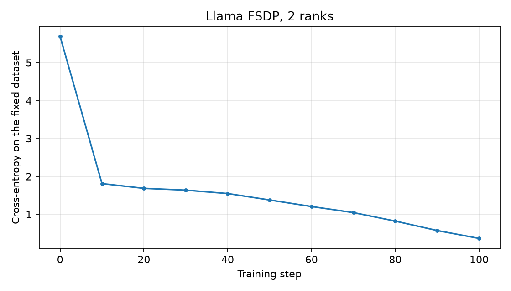

# ДЗ 2

FSDP-обучение Llama из `hw1/model.py` на библиотеке `emugpu` из архива курса.
Модель не копируется и не меняется. Обязательная часть из сообщения от 08.10:
шардирование целых блоков `norm + attention + norm + MLP`.

## реализация

`fsdp.py` оборачивает embedding, каждый из четырёх decoder-блоков и выходные
RMSNorm + LM head в отдельные sharded units. Все процессы проходят всю модель,
обрабатывая разные части общего batch.

У каждой unit параметры выпрямляются и делятся между процессами. Если длина не
кратна числу процессов, в конец добавляются нули. Оптимизатор получает только
локальные shard-параметры; состояния AdamW имеют тот же локальный размер.

Перед forward блока `all_gather` восстанавливает полные веса. После вычисления
они освобождаются вместе с внутренним графом блока. Для backward веса снова
собираются и forward пересчитывается с сохранённого входа. Затем
`reduce_scatter(SUM)` суммирует градиенты всех процессов и возвращает каждому
процессу его часть. Локальный loss — сумма по токенам, делённая на глобальное
число токенов, поэтому неравные и пустые local batch учитываются правильно.

`train.py` запускает процессы через `World`, создаёт mesh с осью `fsdp`,
обучает модель и сохраняет конфиги, loss и график. Оценка loss проходит по
всему конечному набору: каждый процесс считает свою часть.

## запуск

Все команды выполняются из корня репозитория, Python 3.12.

```powershell
python -m pip install --extra-index-url https://download.pytorch.org/whl/cu128 -r hw2/requirements.txt
python -m pip install -e ./vendor/emugpu
python -m hw2.verify
python -m hw2.train --config hw2/config.json --device cpu
```

Запуск на одной общей RTX 3070 Ti Laptop с разными local batch:

```powershell
python -m hw2.verify --world-sizes 2 --device cuda:0 --output hw2/verification_cuda.json
python -m hw2.train --config hw2/config.json
```

Входной `hw2/config.json` задаёт модель, обучение (включая число процессов,
local batch и seed) и данные. Он читается до запуска `World` и создания модели.
Параметры модели совпадают с ДЗ 1, используется тот же связный корпус.
В коде импортируется `LlamaLM` из `hw1/model.py`; отдельной новой реализации
Llama здесь нет. Запуск не требует изменений в файлах первой работы.

Пути данных считаются относительно входного конфига. `device: "auto"` выбирает
CUDA, если она доступна, иначе CPU. Отдельные настройки можно переопределить
аргументами командной строки. Результаты сохраняются в `hw2/results`, путь меняется
через `--output-dir`. `resolved_config.json` содержит фактически использованные
настройки и текст, а `run_config.json` — измерения и сведения о запуске.
Флаг `--trace path.json` сохраняет подробный trace обменов.

## проверки

`verify.py` сравнивает logits, полные градиенты, веса после обновления и оба
момента AdamW с обычной Llama на общем batch. Запускаются три шага, включая
неравные local batch и пустой batch на rank 0. Тест с тремя процессами также
проверяет padding shard-ов. Инициализация остальных ranks отличается от rank 0,
чтобы проверить начальную синхронизацию весов.

Проверяется, что у параметров и градиентов локальное хранилище без ссылки на
полный буфер, у optimizer только локальные состояния, а шаблоны весов лежат на
`meta`. Число `reduce_scatter` должно совпадать с числом units × training steps.

Пройдены CPU-запуски на 1, 2, 3 процессах и CUDA-запуск на 2 процессах.
Численные результаты — `verification_cpu.json` и `verification_cuda.json`.

## результат обучения

На RTX 3070 Ti Laptop запуск с двумя процессами и local batch 3 и 5 снизил
loss на всём обучающем наборе с 5,6925 до 0,3671 за 100 шагов. Точность
следующего байта выросла с 0,5% до 90,1%. Это тот же конечный корпус из ДЗ 1,
без отдельной проверки обобщения на новые тексты.



Из 3 148 032 параметров модели каждый rank хранит 1 574 016. Два момента AdamW
содержат вместе 3 148 032 чисел на rank вместо 6 296 064 у полной модели.
Это размеры постоянных тензоров, а не измерение общей занятой VRAM:
при вычислении unit временно собираются полные веса и градиенты.
В trace каждого rank за обучение есть 600 `reduce_scatter`: 6 units × 100 шагов.

## особенности

Это учебная реализация для нашей детерминированной Llama, без dropout и buffers.
Используются синхронные обмены и пересчёт forward в backward, без prefetch и
перекрытия вычислений с коммуникациями. Поддерживается первый порядок autograd.

В `emugpu` транспорт всегда CPU/Gloo, даже при вычислениях на CUDA.
Его `reduce_scatter` реализован через `all_reduce` и локальный срез. В нашей
обёртке этот срез клонируется, чтобы не удерживать полный буфер градиентов.
Несколько процессов на одной GPU делят её память; этот запуск проверяет
семантику FSDP и не измеряет ускорение на нескольких физических GPU.
